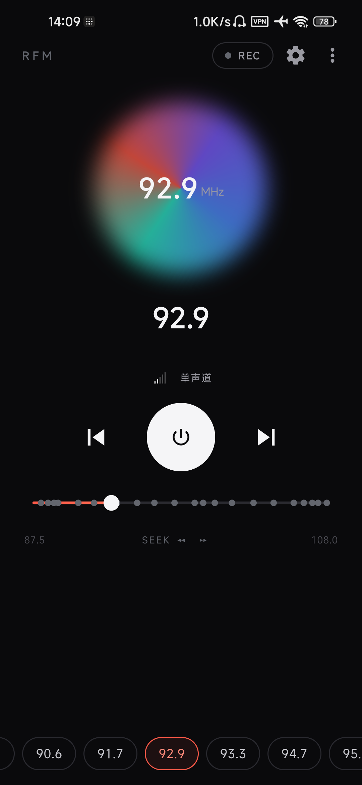
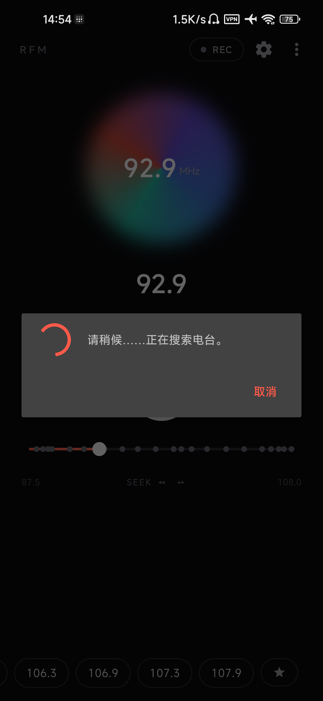
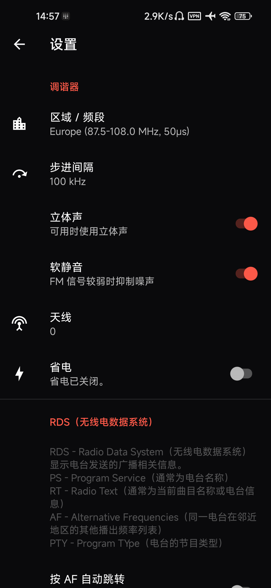

# RFM Radio [](https://github.com/W0n9/RFM-Radio/releases/latest)

[English](README.md) | 简体中文

Android 真·FM 硬件收音机应用。它通过 root 原生后端直接驱动设备内置的 FM 调谐器 —— 不依赖任何网络流媒体。

本项目是 [vladislav805/RFM-Radio](https://github.com/vladislav805/RFM-Radio) 的活跃维护 fork；APK 发布均出自本仓库。与上游相比，本 fork 新增了 MediaTek 设备支持、重新设计的界面、媒体键控制，并跟进了最新的 Android target SDK 要求。

## 系统要求

- Android 6.0 及以上（SDK 23+）。
- 需要 root 权限。
- 需要插入有线耳机 —— 它通常充当天线。

## 支持的硬件

原生后端会在运行时自动检测可用的 FM 硬件：

| 后端 | 检测方式 | 已验证设备 |
| --- | --- | --- |
| Qualcomm 传统（V4L2） | 存在 `/dev/radio0` | Redmi 4A（骁龙 425）、Mi A1（骁龙 625） |
| Qualcomm HAL（`fm_helium.so`） | 存在 HAL 库且无 `/dev/radio0` | Poco X3 Pro（骁龙 860） |
| MediaTek（`/dev/fm`） | 存在 `/dev/fm` | Redmi Note 9 5G（MT6853 / MT6631） |

## 功能

- 使用真实调谐器进行 FM 实时播放（Qualcomm 或 MediaTek）。
- RDS 元数据：PS、RT、PTY、PI、AF 以及电台国家/地区。
- 录制为 `.wav` 和 `.mp3`（Qualcomm 设备）。
- 收藏夹：多个可命名列表，支持导入/导出；主屏幕以横向卡片行展示。
- 扬声器播放（MediaTek；请保持耳机插入 —— 部分硬件的扬声器功放取自耳机通路）。
- 播放时支持媒体键与有线耳机按键控制。
- 地区/频段选择（欧洲、美国、日本、日本宽频）、频道步进、立体声、软静音、天线、省电模式。

## 截图



## 构建

克隆时带上子模块（MP3 编码器），或在现有检出版本中初始化：

```bash
git clone --recursive https://github.com/W0n9/RFM-Radio.git
# 或：git submodule update --init --recursive
```

然后构建 —— Android SDK 需通过 `ANDROID_HOME` 或 `local.properties` 提供：

```bash
./gradlew :app:assembleDebug
```

Gradle 会自动交叉编译 `native/` 下的原生 FM 后端并打入 assets（需要 Android NDK 29.0.14033849 与 CMake 3.22.1）。原生宿主测试：`make test-native`。

## 灵感来源

> Spirit1 与 Spirit2，作者 Mike Reid。
>
> R.I.P. 2016

## 免责声明

本项目基于零散拼凑的 Tavarua、Iris、I2C、V4L2 相关文档 —— 在本 fork 中，还包括对 MediaTek 驱动接口的逆向工程。

## 贡献者

- Vladislav Veluga（[@vladislav805](https://github.com/vladislav805)）—— 原项目开发者
- Mike Reid（[@mikereidis](https://github.com/mikereidis)）—— Spirit 1/2 开发者
- Konstantin Manaev（[@SoSlowMan](https://github.com/SoSlowMan)）—— 翻译（英语）
- Andus（[@AndusDEV](https://github.com/AndusDEV)）—— 翻译（波兰语）
- TsungWing（[@W0n9](https://github.com/W0n9)）—— fork 维护者（MediaTek 后端、界面、现代化）

## 许可证

[GPL-3.0](LICENSE)
